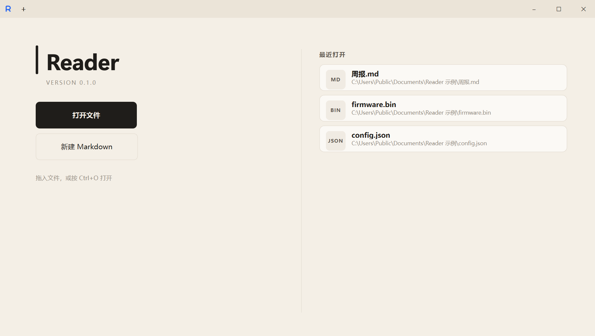
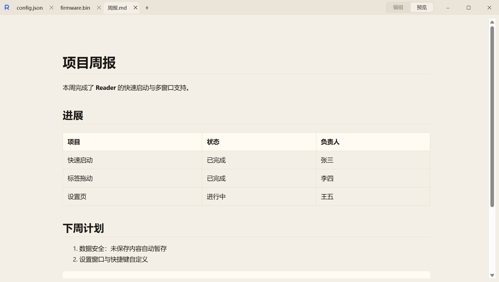
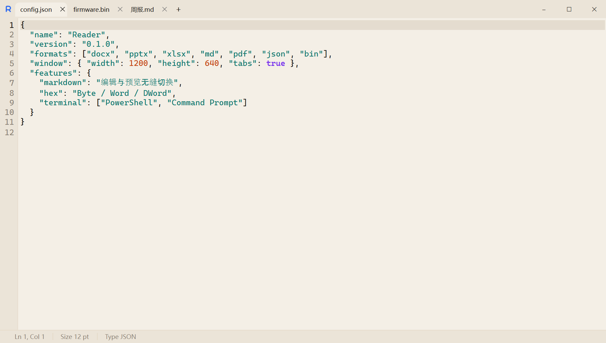
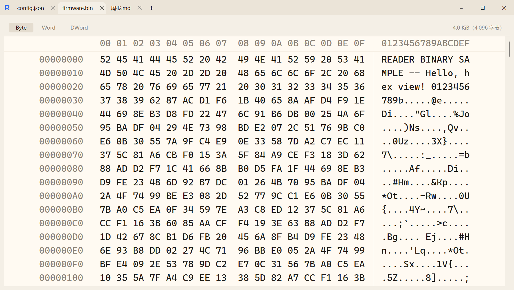

# Reader

Windows 桌面文档查看器：双击就能读 Word、PPT、Excel、Markdown、PDF、源码、图片和二进制文件，记事本一样轻快，不需要安装 Office。当前版本 **1.2.18**。



| Markdown 预览 | 代码编辑 | 十六进制查看 |
|---|---|---|
|  |  |  |

## 能打开什么

| 格式 | 体验 |
|---|---|
| `.docx` / `.xlsx` | 内置预览；装了 Office 时可切「Office 高保真」 |
| `.pptx` | 本地视觉预览（缩略图、翻页、缩放），可切文本模式或 Office 高保真 |
| `.md` | 渲染预览（表格、代码、离线 Mermaid、`[[wikilink]]`）；标题栏「编辑 \| 预览」或 `Ctrl+I` / `Ctrl+T` 无缝切换，预览直接显示未保存内容 |
| `.pdf` | 内置 PDF 阅读器（只读） |
| `.txt` / `.json` / `.yaml` / `.yml` / `.xml` / `.c` / `.h` / `.cpp` / `.hpp` / `.cc` / `.cxx` / `.hh` / `.hxx` / `.inl` / `.ipp` | 记事本式编辑：行号、语法高亮（`.txt` 除外）、撤销/重做、底部状态栏 |
| `.svg` / `.png` / `.jpg` / `.jpeg` / `.gif` / `.webp` / `.bmp` | 只读预览，适应窗口，`Ctrl+滚轮` 缩放（SVG 不执行脚本） |
| `.bin` | 十六进制查看：每行 16 字节，Byte / Word / DWord 切换，右侧 ASCII，悬停两侧联动高亮；内存映射，GB 级文件也秒开 |

不支持旧版 `.doc` / `.ppt` / `.xls`、HTML 和文件夹。暂不做：翻译、左右对照、格式互转、macOS / Linux。

## 主要功能

- **多窗口，像记事本**：每次在资源管理器双击都开一个新窗口，所有窗口共用一个后台进程，已运行时再打开约 1 秒；已打开的文件直接切到它所在的标签。
- **标签可以拖动**：拖出成新窗口、拖进别的 Reader 窗口合并，或右键「移到新窗口」；未保存的编辑、终端会话、预览都原样保留。
- **编辑安全**：保留原编码（UTF-8 / UTF-8 BOM / UTF-16 BOM / GB18030）和换行，原子写入；无法无损识别编码的文件只读；关闭前询问「保存 / 不保存 / 取消」。
- **历史版本**：每次保存覆盖前自动保留旧内容（每个文件 20 份、30 天）；右键标签「历史版本」只读查看，一键「恢复为此版本」。
- **未保存内容不会丢**：编辑中的内容自动暂存；Windows 注销、关机或 Reader 崩溃后，下次启动直接恢复这些标签（像 Win11 记事本）。
- **标题栏 `+` 菜单**：新建文件（Markdown 草稿）、打开文件、Browser 标签（隐私模式网页浏览）、Terminal 标签（PowerShell / Command Prompt 真终端）。
- **查找替换**：`Ctrl+F` 查找、`Ctrl+H` 替换、`Ctrl+J` 转到行。
- **欢迎页**：最近打开的文件、拖入文件打开。
- 启动时注册为资源管理器「打开方式」候选，并在桌面创建快捷方式；不会改动你已选的默认应用。

## 快捷键

| 按键 | 作用 |
|---|---|
| `Ctrl+O` | 打开文件 |
| `Ctrl+N` | 新建文本 |
| `Ctrl+Shift+T` | 重新打开刚关闭的标签（对应磁盘文件的标签，所有窗口共享最近 20 个） |
| `Ctrl+S` / `Ctrl+Shift+S` | 保存 / 另存为 |
| `Ctrl+F` / `F3` / `Shift+F3` / `Esc` | 查找 / 下一个 / 上一个 / 关闭查找 |
| `Ctrl+H` | 替换 |
| `Ctrl+J`（或 `Ctrl+G`） | 转到行 |
| `Ctrl+I` / `Ctrl+T` | Markdown 编辑 / 预览 |
| `Ctrl+=` / `Ctrl+-` / `Ctrl+0` | 代码与文本字号（8–24pt） |
| `Ctrl+滚轮` | 代码、文本、BIN 调字号；图片、SVG、PPTX 缩放 |
| `Alt+Z` | 代码与文本自动换行 |
| `Ctrl+单击` 网址 | 在文本、代码和 Markdown 编辑视图里用默认浏览器打开 http(s) 链接（按住 Ctrl 悬停时显示下划线） |
| `←` `→` / `PageUp` `PageDown` / `Home` `End` | PPTX 翻页 |

## 安装与运行

需要 Windows 10/11、**Python 3.12+**；打包成 exe 还需要 **Node.js 18+**。没有 Python 时先执行：

```text
winget install Python.Python.3.12
```

在仓库根目录运行：

```text
powershell -NoProfile -ExecutionPolicy Bypass -File scripts\setup.ps1
```

脚本会创建 `.venv`、安装固定版本的依赖，调用 `scripts\build_windows.ps1` 打出 `dist\Reader\Reader.exe`（约 600 MB，含 Qt WebEngine）并启动。

- 只装依赖并打包、不启动：加 `-SkipLaunch`
- 只用源码运行、不打包（不需要 Node）：加 `-SkipBuild`
- 开发者需要测试依赖：加 `-Dev`

## 开发

流程见 `AGENTS.md` 和 `docs/superpowers/process.md`：先写规格和计划，按 TDD（先失败的测试，再实现）开发，每次修改单独提交并推送。

```text
powershell -NoProfile -ExecutionPolicy Bypass -File scripts\verify.ps1            # 快速质量门
powershell -NoProfile -ExecutionPolicy Bypass -File scripts\verify.ps1 -Release   # 发布门：冻结构建 + GUI 冒烟
powershell -NoProfile -ExecutionPolicy Bypass -File scripts\install_local.ps1     # 安装到 %LOCALAPPDATA%\Programs\Reader
python scripts\bump_version.py                                                    # 发布前：版本号加 1
```

`main` 分支和 pull request 在 Windows CI 上运行同一快速质量门。

## 文档

- 功能全解：`docs/Reader功能全解.md`
- 当前进度：`docs/STATUS.md`
- 更新日志：`CHANGELOG.md`

## 许可

Reader 代码采用 [MIT 许可](LICENSE)。打包内含的 Qt / PySide6（LGPL-3.0）等第三方组件见 [THIRD_PARTY_NOTICES.md](THIRD_PARTY_NOTICES.md)。